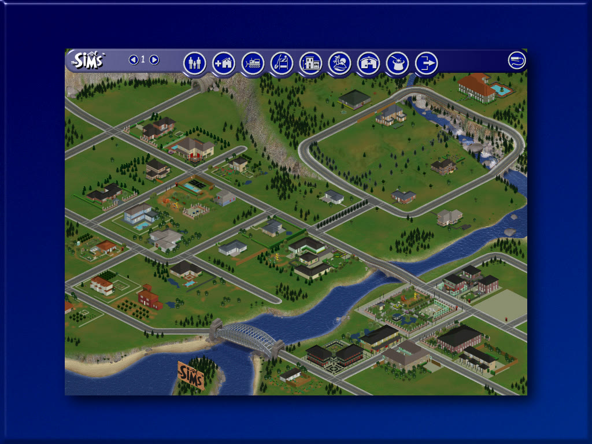
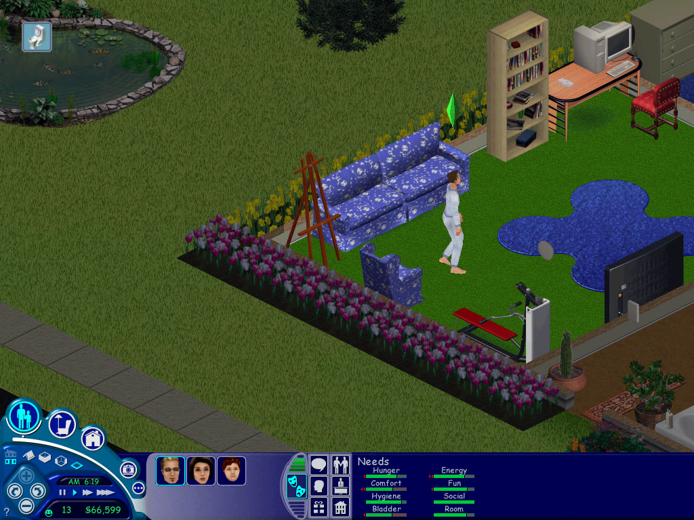
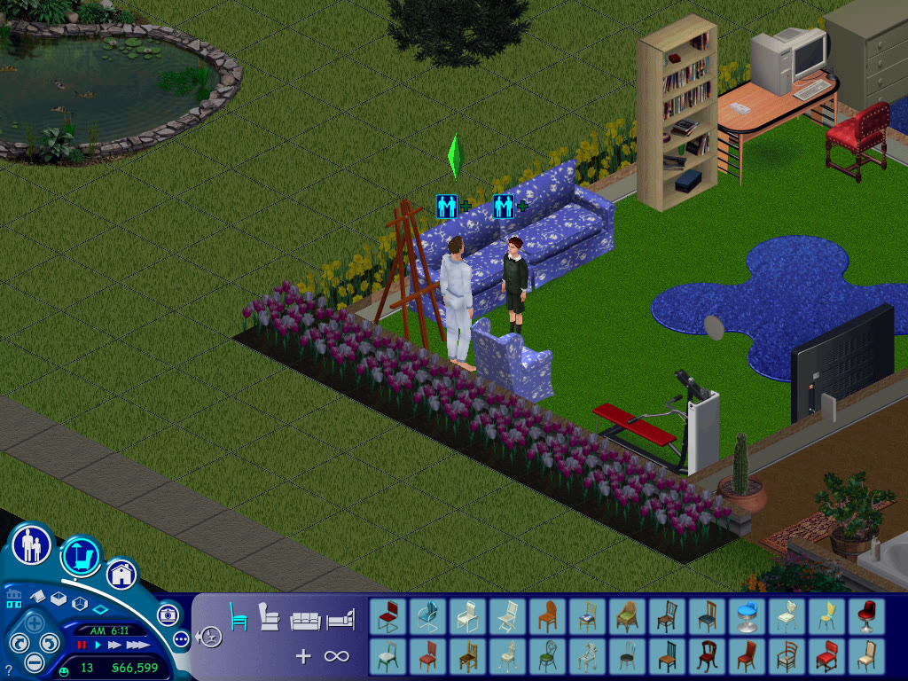
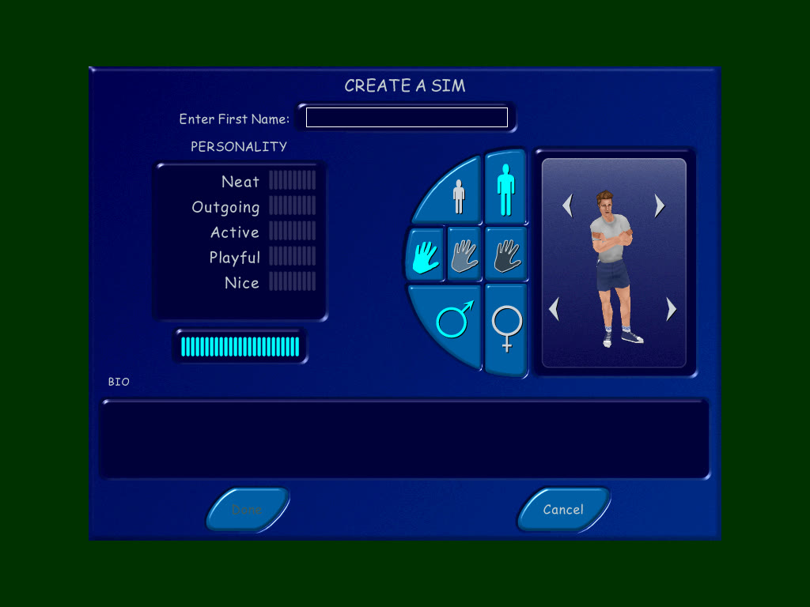
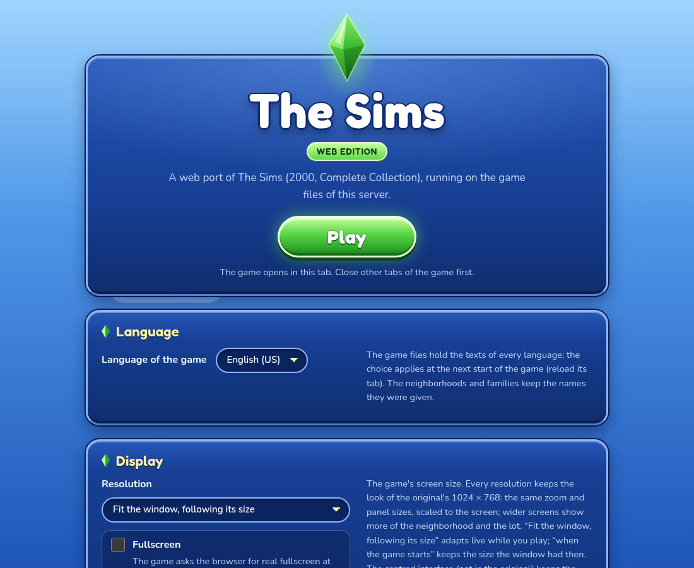

# thesimsweb

A web port of **The Sims (Maxis, 2000) Complete / Deluxe Edition**.

The goal: play the game in a modern browser, with nothing to install, from the
files of your own legal installation of the game.

> ⚠️ This project **does not distribute any Maxis / EA asset**. To play, you need
> your own copy of the game (CD, or an Origin / EA App installation).

## Status

- The game shell is ported class by class from a decompilation of the original
  game (`client/game.html`, `client/src/game/`, see [`docs/decomp/`](./docs/decomp/)).
  The SimAntics VM runs the original behaviour code (BHAV) straight from the
  game's `.iff` files.
- Playable end to end: neighborhood, Create-a-Sim, live / buy / build modes,
  saves, downtown. Current phase: playtesting and fixes
  ([`docs/decomp/playtest.md`](./docs/decomp/playtest.md)); what is left is listed
  in [`docs/TODO.md`](./docs/TODO.md).
- Browsers: Firefox and Chromium-based browsers (desktop and Android); Safari
  on a best-effort basis.
- Emulation (v86 / Boxedwine) was tried first and rejected: see
  [`docs/decision-A-vs-D.md`](./docs/decision-A-vs-D.md).

## Screenshots

| | |
|---|---|
|  |  |
| Neighborhood | Live mode |
|  |  |
| Buy mode | Create a Sim |



*The landing page: play, game language, display, game files and saves.*

## What the port adds

The game itself is kept as close to the original as possible. Around it, the
port adds what a browser game needs:

- **Nothing to install for the player**: the game runs in Firefox or a
  Chromium-based browser, on desktop and Android (touch controls, still being
  polished). It can be installed as an app (PWA).
- **Any screen size**: from 800 × 600 up to 5120 × 2160 (32:9 included), keeping
  the look of the original 1024 × 768 (same zoom, same panels, scaled up) instead of
  shrinking everything. The game can follow the window size while you play.
- **Centred interface** on very wide screens (optional) and **real fullscreen**
  (optional, or Alt+Enter at any time).
- **Game language** picked on the landing page, among every language the game
  files hold, without reinstalling.
- **Two save modes**: one shared set of saves on the server, or each browser
  keeps its own (IndexedDB). Saves can be **exported and imported** as a ZIP
  archive.
- **Bring your own game**: an instance can serve no game file at all; each
  player then imports their own copy of the game into their browser.
- **Installation check**: the landing page (and `pnpm check-game`) compares
  the game folder with a complete installation and lists what is missing.
- **Offline play**: once launched, the game restarts without a connection
  (service worker + IndexedDB cache). The game files most sessions need
  (about 340 MB) can be **downloaded ahead of time** from the landing page, with
  a progress bar, and cleared again.
- **Streamed game files**: they are fetched on demand with
  HTTP Range requests and cached in the browser, so later launches take a few
  seconds.
- **Docker image** for self-hosting, built by GitHub Actions.

## Getting started with Docker

The easiest way to run it on a server or a home machine. You need Docker with
the compose plugin, and the install folder of The Sims (the one that contains
`GameData/`, `UserData/`, `ExpansionShared/`...).

```bash
git clone <this repository> thesimsweb && cd thesimsweb
cp .env.example .env
# edit .env: SIMS_DIR=/path/to/The Sims   (the game folder, mounted read-only)
docker compose up -d --build
```

Then open `http://127.0.0.1:3000/`. The landing page lets you play, download the
game files ahead of time for offline play, and export / import saves.

Main settings in `.env` (all documented in [`.env.example`](./.env.example)):

| Variable | Default | Meaning |
|---|---|---|
| `SIMS_DIR` | `./server/assets/Sims` | The game's install folder, never written to. |
| `THESIMSWEB_PORT` | `3000` | Published port. |
| `THESIMSWEB_BIND` | `127.0.0.1` | `0.0.0.0` to expose it on the network. |
| `THESIMSWEB_SAVES` | `server` | `server`: one shared set of saves, in a Docker volume. `client`: each browser keeps its own saves. |
| `THESIMSWEB_GAME_FILES` | `server` | `client`: the server serves no game file; each player imports their own copy of the game into their browser. |

Update after a `git pull`: `docker compose up -d --build` (saves are kept in the
`saves` volume). The server has **no authentication**: keep it on a private
network or behind a reverse proxy with authentication. Prebuilt images, reverse
proxies, save migration and the other modes: [`docs/docker.md`](./docs/docker.md).
Player's guide: [`docs/user-guide.md`](./docs/user-guide.md).

## Running from source

You need Node 22, pnpm 10, and Rust with `wasm-pack` (the engine is compiled to
WebAssembly); see [`docs/DEVELOPMENT.md`](./docs/DEVELOPMENT.md). Point the
server at your own installation of the game first:

```bash
pnpm install
mkdir -p server/assets
ln -s "/path/to/The Sims" server/assets/Sims   # read-only is fine
pnpm start                                      # → http://127.0.0.1:3000/
```

`pnpm start` (`scripts/start.mjs`) rebuilds whatever is stale — the WASM engine,
the client bundle (`client/dist/`, vite) and the server (`server/dist/`, tsc) —
then runs the Fastify server, which serves the game at `/` next to `/assets`,
`/api/*` and the save overlay.

- Port / interface: `pnpm start --port 4000` (or `PORT=4000`), `HOST=0.0.0.0 pnpm start` for the LAN.
- `pnpm start --rebuild` forces every build step, `--no-build` only runs the server.
- `pnpm build` builds everything without starting anything; `pnpm check-game` checks that the game folder is complete.
- URL options: `/?nbhd=UserData2` opens another neighborhood, `/?house=1` goes straight into a lot.
- Saves never touch the game folder: they go to `server/data/overlay/Sims/UserData*/`,
  which shadows the originals (delete a folder there to reset that neighborhood).

Development (Vite dev server with hot reload):

```bash
pnpm install
wasm-pack build --target web --scope thesimsweb crates/wasm-bindings
pnpm dev   # → client http://localhost:5173/  ·  server http://127.0.0.1:3000/
```

## Stack

- **Client**: strict TypeScript, Vite, WebGL 2, Web Audio, IndexedDB, a service worker for offline play.
- **Engine**: Rust → WebAssembly (`#![no_std]` crates, `wasm-pack`, exposed to the pnpm workspace as `@thesimsweb/wasm-bindings`).
- **Server**: Fastify (Node 22), `@fastify/static` with Range requests; saves are written to an overlay (`server/data/overlay/`), the game folder stays read-only.

## Layout

```
client/                 Vite + TS frontend (landing page, game, service worker)
server/                 Fastify backend (asset streaming, save overlay, built client)
crates/
  iff/                  Maxis IFF parser
  far/                  FAR archive parser
  sprite/               SPR2 / RLE / palette decoder
  simantics/            SimAntics helpers
  audio/                Audio decoders
  wasm-bindings/        wasm-pack cdylib exposing the above to TS
docs/                   Format specs, porting notes and design decisions
scripts/, tools/        Build, start and decompilation helper scripts
```

## License

[GNU General Public License v3.0 or later](./LICENSE).

The Sims™ is a trademark of Electronic Arts Inc. This project is not affiliated
with or endorsed by Electronic Arts or Maxis. No game asset is included; you
need your own copy of the game.
